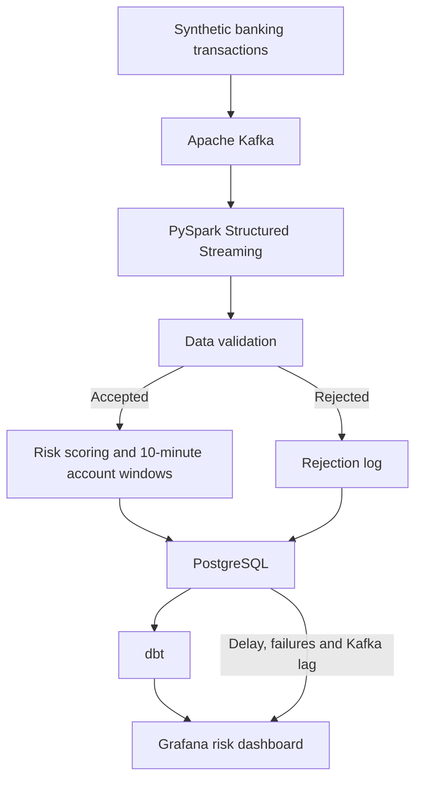

# Banking Transaction Risk Pipeline

This local portfolio project streams synthetic banking transactions through Kafka and PySpark, validates and scores them, and serves PostgreSQL analytics to Grafana through dbt.



## Run the pipeline

Requires Docker Engine with the Docker Compose plugin. The first run downloads container images, Python packages, and the Spark Kafka connector.

```bash
docker compose up -d --wait kafka postgres
docker compose run --rm --build producer
docker compose run --rm --build spark
docker compose run --rm --build dbt
docker compose up -d grafana
```

Open the [Banking Risk dashboard](http://localhost:3000/d/banking-risk) with `admin` / `admin`. On a fresh stack, the sample yields **3 accepted transactions, 1 flagged transaction, and 1 rejection**. Grafana refreshes its queries every 30 seconds. Run `docker compose run --rm dbt` to rebuild the risk analytics and run their tests after new data is processed. Operational panels read directly from PostgreSQL.

Use `GRAFANA_PORT=3300 docker compose up -d grafana` if port 3000 is already in use.

## Generate and process 100,000 transactions

```bash
python3 -m streaming.generate output/synthetic.csv --count 100000
docker compose run --rm -T producer - < output/synthetic.csv
docker compose run --rm spark
docker compose run --rm dbt
```

The generator includes account bursts, high amounts, and 100 deliberately invalid amounts. Use the same `--seed` and `--start` to regenerate the same CSV. Publishing it again preserves its transaction IDs. New runs without an explicit start time generate fresh IDs. Use a fresh Compose project for a standalone load run so that any existing watermark does not classify the oldest generated events as late.

## Validation, scoring and event time

A valid message has transaction and account IDs, a two-letter country code, an hour from 0 through 23, and a nonnegative decimal amount with up to two fractional digits. The optional `event_at` field accepts an ISO 8601 UTC timestamp ending in `Z`, from 1970 onward and up to five minutes ahead of the Kafka timestamp. When omitted, the Kafka timestamp supplies event time. Rejections retain the first validation error, raw payload bytes and Kafka coordinates in `ingest.rejected_transactions`.

| Rule | Points |
| --- | ---: |
| Amount at least 10,000 | 60 |
| Amount at least 50,000 | 80 |
| Hour 00:00–04:59 | 60 |
| Hour 00:00–01:59 | 70 |
| At least five unique accepted transactions for the account in the same 10-minute UTC window | 60 |

Within each amount or hour rule, the highest applicable tier wins. Scores are capped at 100, and scores of 60 or above are flagged. When an account reaches the velocity threshold, earlier eligible transactions in the same window receive the velocity points too.

Spark assigns fixed 10-minute event-time windows and aggregates new accepted transactions by account and window. PostgreSQL holds the running counts between micro-batches. The watermark is the largest accepted event time so far minus five minutes. A window that ended at or before the previous batch's watermark is closed. Valid transactions for closed windows retain their base score and are marked `late_for_velocity`. The watermark moves as newer accepted events arrive.

## Streaming, recovery and monitoring

The default job processes the current backlog with Spark's AvailableNow trigger. Start the managed streaming service with five-second micro-batches and restart-on-failure enabled.

```bash
SPARK_CONTINUOUS=1 docker compose --profile jobs up -d --build spark
docker compose logs -f spark
```

Use one Spark job per checkpoint. The Spark checkpoint persists on a Docker volume. PostgreSQL commits accepted rows, raw rejections, account-window counts, processed Kafka offsets and batch metrics in one transaction. If Spark replays a committed Kafka offset, the database skips it. Publishing a transaction ID again also leaves its row and window count unchanged. The Spark job applies the database migration on startup. Existing accepted rows receive base scores from their stored amount and hour.

Grafana shows risk scores, Kafka lag per partition, per-batch p95 processing delay, rejected and late records, and pipeline failures and write retries. Lag is measured against the offsets committed to PostgreSQL. The continuously running service samples lag while the stream runs. Errors and retry details are also available in Spark logs, including when PostgreSQL is temporarily unavailable.

```bash
docker compose exec postgres psql -U banking -d banking -c "select rejection_reason, count(*) from ingest.rejected_transactions group by 1"
docker compose exec postgres psql -U banking -d banking -c "select * from analytics.daily_risk order by day_utc"
```

`docker compose down` stops the services and preserves their volumes. This stack uses synthetic data and local development credentials.

## Tests

```bash
python3 -m unittest discover -s tests -v
bash tests/streaming_smoke.sh
```

GitHub Actions runs both suites on pushes and pull requests. The integration test uses an isolated Compose project. It covers rejected records, cross-batch velocity, PostgreSQL rollback, checkpoint recovery, late events, replay, Kafka lag, and dbt.

## Standalone Python and SQLite demo

The original pipeline is available with Python 3.10 or later.

```bash
python3 -m src.pipeline
```

It writes `clean.jsonl`, `rejected.json`, `warehouse.db`, and `summary.json` under `output/`. The reporting query is in `sql/analysis.sql`.
